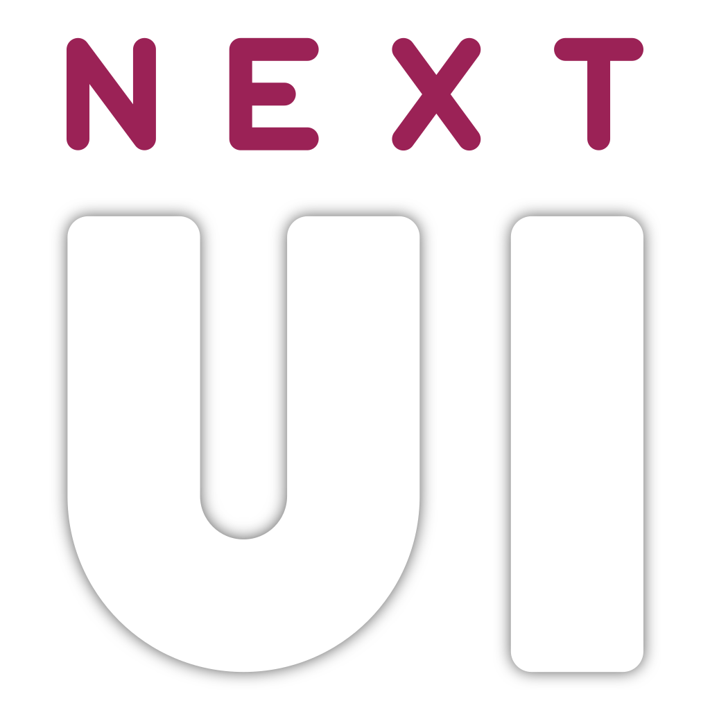

<div align="center">

  

# NextUI for R36J (R36S Clones)

A port of **[NextUI](https://github.com/LoveRetro/NextUI)** for **R36S clones** built on the **Allwinner A33** (`r36j` / `sun8iw5p1`) with **ARM Mali-400 MP2** graphics running Batocera Linux (`3.4.39`).

<p>
  <a href="https://github.com/LoveRetro/NextUI" target="_blank">Upstream NextUI</a>
  ·
  <a href="https://nextui.loveretro.games/docs/" target="_blank">NextUI Docs</a>
  ·
  <a href="README_R36J.md">R36J Port Notes</a>
  ·
  <a href="LICENSE">License</a>
</p>

</div>

---

## About Upstream NextUI

This fork builds on **[NextUI](https://github.com/LoveRetro/NextUI)** (originally derived from [MinUI](https://github.com/shauninman/MinUI)), bringing NextUI's rebuilt low-latency emulation frontend and quality-of-life features to the R36J while tracking upstream UI, `minarch`, and Pak improvements:

- **Rebuilt emulation engine (`minarch`)** with low input latency, hardware-accelerated GPU rendering, and [libsamplerate](https://github.com/libsndfile/libsamplerate) audio resampling
- **Game Switcher** for instant jump-back between recent games
- **GLSL shaders & PNG overlays**, custom aspect/scaling modes, and cheat support
- **Game art & game time tracking**, animated scrolling titles, and CJK-capable `Next` font
- **UI customization** (accent/text colors, fonts, transitions) and **Battery Monitor** (history & time remaining)
- **Automatic NTP time synchronization** with timezones

For TrimUI and Anbernic H700 devices, see [LoveRetro/NextUI](https://github.com/LoveRetro/NextUI).

---

## R36J Port Additions

- **Mali-400 MP2 OpenGL ES 2.0 Pipeline**: Forced GLES 2.0 context creation, `#version 100` shader support, and VBO attribute binding in [`generic_video.c`](workspace/all/common/generic_video.c).
- **Configurable Night Mode**: Built-in f.lux-style warm tinting & optional dimming in **Settings → Display** (`Off` / `On` / `Scheduled`, `2000K`–`6500K`, start/end times, fade duration, and night dim scale), applied uniformly across NextUI, Settings, and `minarch` via GLES2/SDL2.
- **R36J Hardware Integration (`workspace/r36j/`)**: Raw `evdev` input with D-Pad and dual analog sticks, ALSA `Master` audio, AXP223 battery & backlight via `libmsettings`, dynamic CPU frequency scaling, and LED suppression while active/charging.
- **USB Wi-Fi & Networking**: Bundled `8821au.ko` driver (RTL8821AU USB Wi-Fi, 2.4 GHz mode), ConnMan integration, and automatic `udev` hotplug activation (`wifi_hotplug.sh`).
- **Remote Access & Recovery**: Persistent **Dropbear SSH** server on port 22, USB **ADB** hotplug recovery (`adbd_recover.sh`), and a **Restart ADB** tool Pak.
- **Stock Batocera Bridge (`skeleton/SYSTEM/r36j/start_nextui.sh`)**: Automatically maps existing `/userdata/roms`, `/userdata/cores`, `/userdata/Saves`, `/userdata/Bios`, `/userdata/Cheats`, and `/userdata/Overlays` into NextUI without duplicating files.

> See [README_R36J.md](README_R36J.md) for hardware specs and technical port notes.

---

## Supported Target

| Component | Details |
| :--- | :--- |
| **Board / SoC** | `r36j` (`sun8iw5p1`) — Allwinner A33 Quad-core Cortex-A7 |
| **GPU** | ARM Mali-400 MP2 (OpenGL ES 2.0) |
| **RAM** | 256 MB DDR3 |
| **Display** | 640×480 MIPI DSI |
| **Base OS** | Stock Batocera Linux (`3.4.39-armhf-sun8i`) |

---

## Building & Deploying

Requires Docker (`Dockerfile.r36j`):

```sh
./build_r36j.sh
```

This builds the `r36j-toolchain` image, compiles all NextUI binaries and `libmsettings` for `PLATFORM=r36j`, and stages the bundle in `workspace/build/r36j/dist/nextui/`.

To deploy to a handheld connected over USB ADB:

```sh
./deploy_adb.sh
```

See [README_R36J.md](README_R36J.md#installing--deploying-to-the-handheld-via-adb) for initial boot setup (`batocera.conf` / `custom.sh`) and zram swap recommendations.

---

## Quick Controls

**In NextUI Menu:**
- `Select` (short press): Open Game Switcher
- `Start` + `Vol+` / `Vol-`: Adjust display brightness

**In Game (`minarch`):**
- `Menu`: Open in-game menu (states, scaling, shaders, controls)
- `Menu` + `Select`: Open Game Switcher

---

## License & Credits

This project keeps upstream NextUI's **[PolyForm Noncommercial 1.0.0](https://polyformproject.org/licenses/noncommercial/1.0.0)** license. Personal, educational, and non-commercial use is permitted; commercial use is not. See [LICENSE](LICENSE) and [NOTICE](NOTICE).

- Upstream **[NextUI](https://github.com/LoveRetro/NextUI)** & **[MinUI](https://github.com/shauninman/MinUI)** contributors
- [josegonzalez](https://github.com/josegonzalez) for [minui-keyboard](https://github.com/josegonzalez/minui-keyboard)
- [Kenney](https://kenney.nl/assets/input-prompts) for Input Prompts
